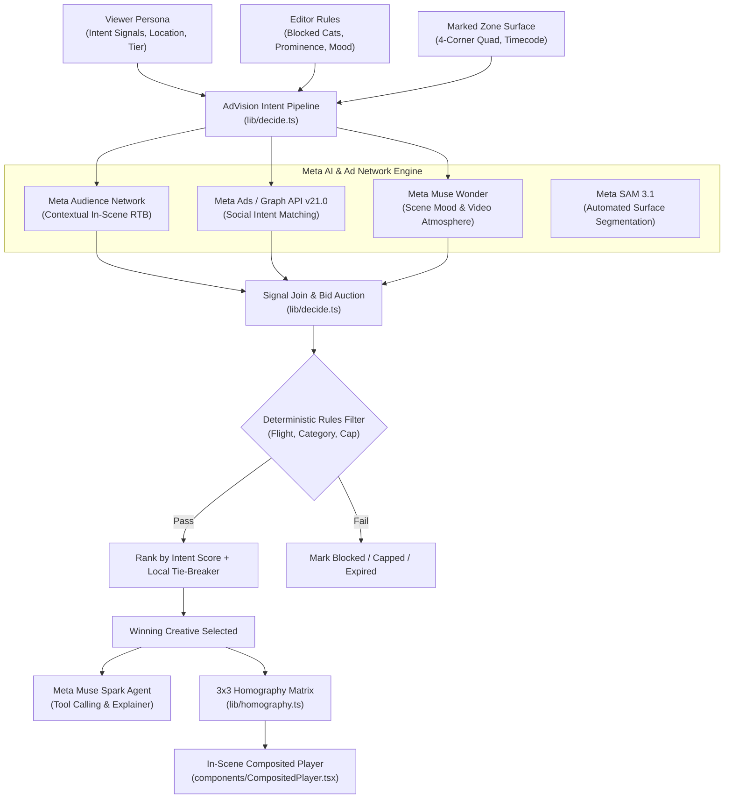
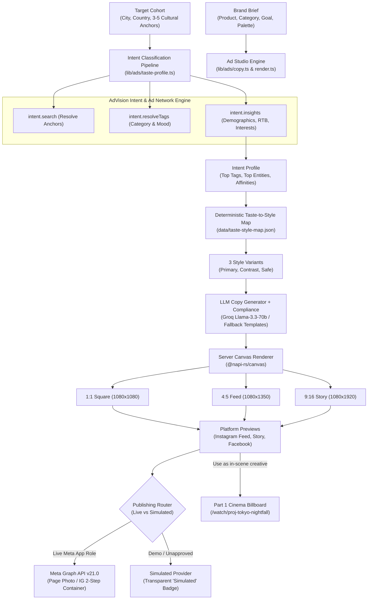

# AdVision: Intent-Based In-Scene Ad Placement with Meta AI

> **Dynamic, contextual in-scene ad placement where Meta AI models (Muse Spark, SAM 3.1, Muse Image, Muse Wonder) and Meta Audience Network determine the brand each viewer sees, while story, timing, and cinematic actors remain 100% identical.**

[](LICENSE)
[](#testing)
[](#meta-hackathon)

---

## What We Built During the Meta Global AI Developer Hackathon (Oct 27 - Nov 4)

- **Unified Meta Model API Adapter ([`lib/ai/meta-client.ts`](lib/ai/meta-client.ts)):** Complete client supporting **Muse Spark** (text reasoning & compliance copy), **Muse Wonder** (video atmosphere understanding), **Muse Image** (creative visual backdrops), and **SAM 3.1** (surface segmentation), with Baseten open-weight fallback (`meta-models/muse-spark-open-1026`) and simulated offline mode.
- **Autonomous Editorial Decision Agent ([`lib/agent.ts`](lib/agent.ts)):** Multi-step tool reasoning engine powered by Muse Spark that queries viewer purchase intent, enforces category & prominence safety guardrails, and renders verifiable audit explanations.
- **AI Surface Scout with SAM 3.1 ([`lib/slotScout.ts`](lib/slotScout.ts)):** Zero-shot video surface detection that automatically segments billboards, extracts planar polygons, and calculates optimal 4-corner bounding quadrilaterals for CSS `matrix3d` homography.
- **Contextual Ad Creative Generator ([`lib/ads/copy.ts`](lib/ads/copy.ts)):** Generates strictly compliant multilingual ad copy and multi-aspect responsive social units (1:1, 4:5, 9:16) with Muse Spark.
- **Meta Ads & Audience Network Ecosystem ([`lib/meta/`](lib/meta/)):** Full integration with Meta Graph API v21.0 (Instagram Stories & Feed publishing, Facebook Pages) and Meta Audience Network programmatic in-scene bidding.

---

## What It Does

AdVision provides a next-generation video-editorial studio and programmatic ad insertion pipeline that allows filmmakers, streaming platforms, and advertisers to mark physical surfaces in footage (such as rooftop LED billboards, storefront signboards, highway gantry signs, or transit posters) and define editorial rules.

Traditional pre-roll and mid-roll commercials interrupt viewer immersion and suffer from high abandonment rates. AdVision turns physical surfaces within the video itself into dynamic, non-intrusive programmatic ad units.

For every individual viewer:
1. **Intent-Based Contextual Classification:** AdVision's intent engine analyzes viewer purchase intent signals, in-market behavior, and real-time scene context (mood, atmosphere, environment) to rank candidate ads.
2. **Meta Audience Network Auctions & Meta Ads:** The system integrates with **Meta Audience Network** for contextual in-scene programmatic display bids and **Meta Ads Manager** for social intent matching.
3. **Editorial Guardrails:** Plain, deterministic code enforces editor constraints—blocking forbidden categories, enforcing whitelist categories, respecting prominence caps, validating flight windows, and applying tie-breakers.
4. **In-Scene 3D Perspective Compositing:** The winning brand creative is rendered and composited onto the marked 4-corner polygon using CSS `matrix3d` homography projections, seamlessly synchronized to the scene's timecode.

If a subscriber has opted into an ad-free tier or is on a kids profile, commercial ads are automatically suppressed in favor of neutral architectural murals or public-service announcements.

---

## Architecture Overview



---

## App Screens & Navigation

1. **`/` Projects:** High-level metric overview (active films, marked surfaces, global markets, pending approvals) and production projects catalog.
2. **`/studio` Studio Editor:** Video preview with draggable 4-corner zone handles, trim and mark zone tools, timeline scrubber with zone blocks, editorial rules panel, and live "Who sees what" multi-viewer matrix.
3. **`/targeting` Intent Targeting:** Detailed intent-classification inspector showing ranked brands with intent score progress bars, status pills, Meta Audience Network & Meta Ads attribution, and 3-step explanation strip.
4. **`/watch/[id]` Cinema Player:** Interactive video player featuring live persona switching (Tokyo, Vizag, SF, BLR, Paris, Kids, Ad-free), perspective-warped in-scene billboards, scannable QR code pause-to-shop card (click or scan to open checkout in a new window), and "Why this ad?" drawer.
5. **`/compare` 4-Way Persona Sync:** Side-by-side synchronized viewports demonstrating the core promise: *one scene, four viewers, one story*.
6. **`/ad-studio` Ad Studio:** Multi-aspect creative generator rendering 1:1, 4:5, and 9:16 responsive ad formats for Meta Audience Network responsive units and Meta feed/story placements.
7. **`/connections` Meta Platforms & Social:** OAuth and credential manager for Meta Audience Network and Meta Ads Manager (Facebook & Instagram).
8. **`/campaigns` Brand Studio:** Campaign builder with instant intent entity resolution and live localized canvas poster preview across Japanese, Telugu, Kannada, French, and English.
9. **`/analytics` Campaign Analytics:** Event telemetry tracking impressions, pause-to-shop inspections, and sponsor click-through rates.

---

## MCP Server (`/api/mcp`)

AdVision exposes a Streamable Model Context Protocol (MCP) server endpoint at `/api/mcp` allowing autonomous AI agents to query AdVision tools:

- `intent_search`: Resolve entity queries to commercial intent URNs.
- `brand_insights`: Query purchase intent and ad network affinity for a market.
- `resolve_tags`: Map scene mood descriptors to commercial intent taxonomy tags.
- `decide_ad`: Execute the full end-to-end decision pipeline.

### Querying the MCP Endpoint
```bash
curl -X POST https://your-deployment.vercel.app/api/mcp \
  -H "Content-Type: application/json" \
  -d '{"jsonrpc": "2.0", "id": "1", "method": "tools/list"}'
```

---

## Setup & Local Development

### Prerequisites
- Node.js 18+ (tested on Node 20 / 22 / 26)
- npm or pnpm

### Installation

```bash
# Clone the repository
git clone https://github.com/Nandanhs006/AdVision.git
cd AdVision

# Install dependencies
npm install

# Copy environment template
cp .env.example .env.local
```

### Environment Variables (`.env.local`)

```ini
# AdVision Commercial Intent & RTB Engine
INTENT_ENGINE_MODE=simulated
GOOGLE_ADSENSE_PUBLISHER_ID=pub-9482-1048-2847
GOOGLE_ADSENSE_API_KEY=
META_GRAPH_API_VERSION=v21.0

# LLM Orchestration (Groq or any OpenAI-compatible provider)
GROQ_API_KEY=your_groq_api_key_here
LLM_BASE_URL=https://api.groq.com/openai/v1
LLM_MODEL=llama-3.3-70b-versatile

# Optional Caching (Upstash Redis) - Falls back to in-memory LRU if unset
UPSTASH_REDIS_REST_URL=
UPSTASH_REDIS_REST_TOKEN=
```

### Running the App

```bash
# Start Next.js development server
npm run dev
```

Visit [http://localhost:3000](http://localhost:3000) in your browser.

---

## Testing & Quality Verification

Run the unified test and quality suite with:

```bash
npm run check
```

This script executes:
1. `npm run typecheck` — Strict TypeScript checking with zero emit errors.
2. `npm run lint` — ESLint checking against Next.js Core Web Vitals.
3. `npm run test` — Vitest unit test suite covering:
   - Qloo client (live fetch, 429 retries, timeouts, LRU caching)
   - Decision pipeline (shortcuts, blocked categories, whitelist, prominence caps, flight expirations, determinism)
   - Homography math & polygon area calculation
   - DecisionAgent fallback safety

---

## Deployment to Vercel

Advision is designed to deploy on Vercel with zero server dependencies:

```bash
# Install Vercel CLI if needed
npm install -g vercel

# Deploy
vercel
```

Add the environment variables in Vercel Project Settings. Verify health status by checking the public endpoint:
```
GET /api/health
```

---

## Part 2: Ad Studio (Intent-Driven Social Ads & Meta Connect)

AdVision Part 2 extends the platform into a brand-side **Ad Studio**. A brand enters a product brief and defines a target **cohort** (e.g. *Tokyo Tech Creators*, *NYC Street Culture*, or *Coastal Arts Community*). AdVision's commercial purchase intent engine classifies that cohort across artists, films, places, and brands, and deterministically turns the intent profile into **production-grade social ad templates** (palette, typography, layout archetype, motif, and tone) plus localized copy.

The brand previews the creatives inside Instagram feed, Instagram story, and Facebook post mockups, exports multi-aspect PNG posters (1:1, 4:5, 9:16), and publishes them directly or simulates publication through connected social accounts.



### How Intent Classification Powers the Ad Studio
1. **Anchor Resolution (`/search`):** Parallel resolution of 3 to 5 cultural and intent anchors (e.g. *Haruki Murakami*, *Tyler The Creator*, *Dumbo Brooklyn*) into verified taxonomy entity URNs.
2. **Multi-Domain Commercial Intent Insights (`/v2/insights`):** Queries commercial affinity vectors across at least four distinct entity categories:
   - `urn:entity:artist` — Musical and performing artists defining cohort sonic taste.
   - `urn:entity:movie` — Cinematic, film, and television aesthetics.
   - `urn:entity:place` — Architectural landmarks, third wave cafes, and neighborhood cultural hubs.
   - `urn:entity:brand` — Existing commercial brands with high cohort affinity.
3. **Affinity-Weighted Tag Aggregation:** Extracts explainability signals and descriptive tags from top entities, normalizes weights, strips uninformative stop words (*general, item, brand, correlation*), and isolates the **top 8 intent tags**.
4. **Contextual Ad Network Routing:** Automatically identifies whether the campaign maps to Meta Audience Network in-scene programmatic units (optics, electronics, automotive, tech) or Meta Ads social placements (beverages, apparel, lifestyle, food).

### Deterministic Taste-to-Style Mapping Table (28 Rules)
Design tokens are selected deterministically by scoring tag rules against intent tag weights (tie-broken stably via cohort ID hashing):

| Domain / Mood | Trigger Keywords | Layout Archetype | Type Style | Palette (bg / fg / accent) | Visual Motif |
| :--- | :--- | :--- | :--- | :--- | :--- |
| **Ambient / Minimal** | `ambient`, `sakamoto`, `meditative` | `minimal-center` | `geometric-sans` | `#0f172a` / `#f8fafc` / `#38bdf8` | `waves` |
| **Cyberpunk / Tech** | `cyberpunk`, `neon`, `futuristic` | `bold-type` | `geometric-sans` | `#0b0f19` / `#f1f5f9` / `#06b6d4` | `grid` |
| **Hip-Hop / Urban** | `hip-hop`, `tyler`, `rhythmic`, `street` | `split-panel` | `condensed-bold` | `#18181b` / `#fafafa` / `#eab308` | `grain` |
| **Indie / Folk** | `indie`, `acoustic`, `vinyl`, `kuhad` | `collage-grid` | `editorial-serif` | `#292524` / `#f5f5f4` / `#f97316` | `grain` |
| **Classical / Symphonic**| `classical`, `symphonic`, `rahman` | `minimal-center` | `editorial-serif` | `#1c1917` / `#fafaf9` / `#ca8a04` | `circles` |
| **Jazz / Late Night** | `jazz`, `improvisation`, `nujabes` | `split-panel` | `editorial-serif` | `#171717` / `#f5f5f5` / `#0284c7` | `waves` |
| **Rock / Raw Energy** | `rock`, `guitar`, `punk`, `energy` | `bold-type` | `condensed-bold` | `#0a0a0a` / `#ffffff` / `#dc2626` | `stripes` |
| **Artisan Coffee** | `coffee`, `roast`, `kissa`, `brew` | `split-panel` | `editorial-serif` | `#1c1512` / `#fbf8f5` / `#c27803` | `grain` |
| **Botanical Tea** | `tea`, `chai`, `botanical`, `malabar` | `minimal-center` | `editorial-serif` | `#141f17` / `#f4f8f4` / `#15803d` | `waves` |
| **Street Food / Spice** | `street-food`, `spicy`, `culinary` | `bold-type` | `condensed-bold` | `#1f130b` / `#fff7ed` / `#ea580c` | `stripes` |
| **Streetwear / Drop** | `streetwear`, `sneaker`, `supreme` | `bold-type` | `condensed-bold` | `#0a0a0a` / `#ffffff` / `#84cc16` | `stripes` |
| **Adventure / Touring** | `adventure`, `racing`, `speed`, `mrf` | `story-vertical` | `condensed-bold` | `#18181b` / `#fafafa` / `#f59e0b` | `stripes` |
| **Retail Special Offer** | `sale`, `discount`, `price`, `deal` | `price-badge` | `condensed-bold` | `#030712` / `#ffffff` / `#ef4444` | `stripes` |

### Meta Integration: Endpoints, Flow & Permissions
Advision integrates with Meta Graph API v21.0 following strict least-privilege principles:
- **Permissions Requested:**
  - Facebook: `pages_show_list`, `pages_read_engagement`, `pages_manage_posts`
  - Instagram: `instagram_basic`, `instagram_content_publish`, `pages_show_list`
- **Facebook Photo Publish Flow:**
  `POST https://graph.facebook.com/v21.0/{page-id}/photos` with `url` and `caption`.
- **Instagram Professional Two-Step Flow:**
  1. Rate Limit Pre-Check: `GET https://graph.facebook.com/v21.0/{ig-user-id}/content_publishing_limit`
  2. Media Container Creation: `POST https://graph.facebook.com/v21.0/{ig-user-id}/media` with `image_url` and `caption`.
  3. Container Status Polling: `GET https://graph.facebook.com/v21.0/{container-id}?fields=status_code`
  4. Media Publish: `POST https://graph.facebook.com/v21.0/{ig-user-id}/media_publish` with `creation_id`.

### Meta Development Mode Honesty & Simulated Mode
Under Meta developer policies, unapproved apps in Development Mode can only make live API calls for accounts with an explicit role (Admin/Developer/Tester) inside the Meta App.
- **Simulated Provider:** For seamless testing, Advision features a built-in `SimulatedProvider` (`META_MODE=simulated`). It accepts identical payloads, validates constraints, returns realistic mock post IDs (`sim_fb_...`, `sim_ig_...`), and attaches a visible `Simulated` badge to all demo outputs. A simulated publish is never presented as live.

### Privacy Stance & Token Security
- **Cohort-Level Only:** Advision never collects, tracks, or stores individual viewer profiles or private messages.
- **AES-256-GCM Encryption:** All Meta access tokens are encrypted at rest with AES-256-GCM using `TOKEN_ENCRYPTION_KEY`.
- **Secrets Stay Server-Side:** Tokens are never logged, never included in client bundles, and redacted from all `/api/connections` responses.
- **Complete Disconnect:** Clicking "Disconnect" on `/connections` permanently purges the connection record and wipes encrypted tokens from disk and memory.

---

## Limitations & Roadmap

- **Creatives:** In this release, creatives are rendered as procedural, localized graphic posters on canvas. Photorealistic generative video repainting (diffusion-based in-painting) is planned for future roadmap iterations.
- **Fictional Data Notice:** All brand names, campaign copy, and personas in this demo are fictional creative examples constructed for research and hackathon demonstration purposes.
- **Simulated Mode:** When running in simulated mode (`INTENT_ENGINE_MODE=simulated`), AdVision automatically supplies realistic commercial purchase intent scores and real-time bidding auction metrics marked with visible badges.

---

## License

This project is licensed under the **MIT License**. See the [LICENSE](LICENSE) file for complete details.

---

## Inspiration and Credits

Inspired by the future of personalized cinematic storytelling and powered by **Intent-Based In-Scene Advertising with Meta AI & Meta Audience Network**.
