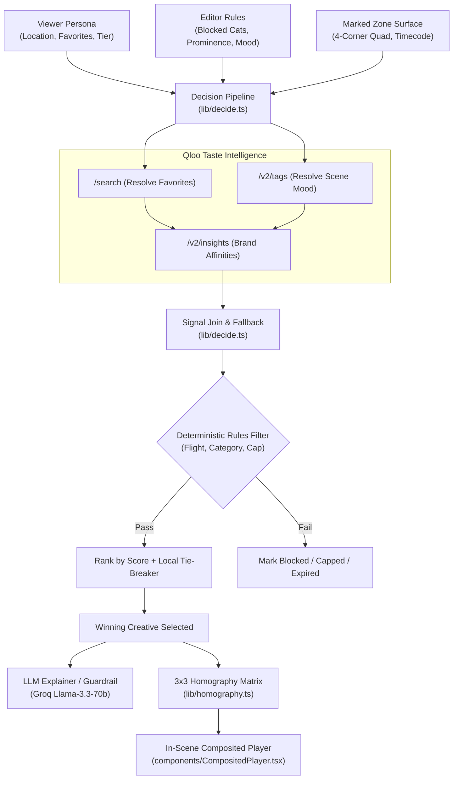

# Advision: Qloo-Powered In-Scene Ad Placement

> **Dynamic, contextual in-scene ad placement where Qloo's taste graph determines the brand each viewer loves, while story, timing, and cinematic actors remain identical.**

[](LICENSE)
[](#testing)

---

## What It Does

Advision provides a video-editorial studio and delivery pipeline that allows filmmakers, streaming platforms, and advertisers to mark surfaces in footage (such as rooftop LED billboards, storefront signboards, or transit posters) and define editorial rules.

For every individual viewer:
1. **Taste Graph Match:** Qloo's cultural intelligence analyzes the viewer's affinity signals (favorite cultural entities, regional market preferences, and scene atmosphere) to rank candidate brands.
2. **Editorial Guardrails:** Plain, deterministic code enforces the editor's constraints—blocking forbidden categories, enforcing whitelist categories, respecting prominence caps, validating flight windows, and applying tie-breakers.
3. **In-Scene Perspective Compositing:** The winning brand creative is rendered and composited onto the marked 4-corner polygon using CSS `matrix3d` homography projections, seamlessly synchronized to the scene's timecode.

If a subscriber has opted into an ad-free tier or is on a kids profile, commercial ads are automatically suppressed in favor of neutral architectural murals or public-service announcements.

---

## Why It Is Qloo-Powered (Endpoints & Architecture)

Qloo is the central decision-maker. If Advision behaved identically without Qloo, it would be non-functional.

### Exact Qloo Endpoints Used

| Endpoint | Location in Code | Purpose |
| :--- | :--- | :--- |
| `GET /search` | [`lib/qloo/client.ts`](lib/qloo/client.ts) | Resolves viewer favorite names and brand names to verified Qloo entity IDs. |
| `GET /v2/insights` | [`lib/qloo/client.ts`](lib/qloo/client.ts) | Queries brand affinities using `filter.type=urn:entity:brand`, `signal.interests.entities`, `signal.interests.tags`, `filter.location.query`, and `feature.explainability=true`. |
| `GET /v2/tags` | [`lib/qloo/client.ts`](lib/qloo/client.ts) | Translates cinematic scene moods (e.g. *neon*, *rainy*, *introspective*) into standardized Qloo tag IDs. |
| `GET /v2/insights/compare` | [`lib/qloo/client.ts`](lib/qloo/client.ts) | Computes cultural taste overlap between global markets. |
| `GET /v2/audiences` | [`lib/qloo/client.ts`](lib/qloo/client.ts) | Fetches cohort and demographic audience taste segments. |

---

## Architecture Diagram



---

## App Screens & Navigation

1. **`/` Projects:** High-level metric overview (active films, marked surfaces, global markets, pending approvals) and production projects catalog.
2. **`/studio` Studio Editor:** Video preview with draggable 4-corner zone handles, trim and mark zone tools, timeline scrubber with zone blocks, editorial rules panel, and live "Who sees what" multi-viewer matrix.
3. **`/targeting` Qloo Targeting:** Detailed taste-graph inspector showing ranked brands with affinity progress bars, status pills, raw Qloo API trace logs, and 3-step explanation strip.
4. **`/watch/[id]` Cinema Player:** Interactive video player featuring live persona switching (Tokyo, Vizag, SF, BLR, Paris, Kids, Ad-free), perspective-warped in-scene billboards, scannable QR code pause-to-shop card (click or scan to open checkout in a new window), and "Why this ad?" drawer.
5. **`/compare` 4-Way Persona Sync:** Side-by-side synchronized viewports demonstrating the core promise: *one scene, four viewers, one story*.
6. **`/campaigns` Brand Studio:** Campaign builder with instant Qloo entity resolution and live localized canvas poster preview across Japanese, Telugu, Kannada, French, and English.
7. **`/analytics` Campaign Analytics:** Event telemetry tracking impressions, pause-to-shop inspections, and sponsor click-through rates.

---

## MCP Server (`/api/mcp`)

Advision exposes a Streamable Model Context Protocol (MCP) server endpoint at `/api/mcp` allowing autonomous AI agents to query Advision tools:

- `qloo_search`: Resolve entity queries to Qloo URNs.
- `qloo_brand_insights`: Query Qloo brand affinities for a market.
- `resolve_tags`: Map scene mood descriptors to tag entities.
- `decide_ad`: Execute the full end-to-end decision pipeline.

### Querying the MCP Endpoint
```bash
curl -X POST https://your-deployment.vercel.app/api/mcp \
  -H "Content-Type: application/json" \
  -d '{"jsonrpc": "2.0", "id": "1", "method": "tools/list"}'
```

---

## Setup & Local Development

### Prerequisites
- Node.js 18+ (tested on Node 20 / 22 / 26)
- npm or pnpm

### Installation

```bash
# Clone the repository
git clone https://github.com/chiraghs/Advision.git
cd Advision

# Install dependencies
npm install

# Copy environment template
cp .env.example .env.local
```

### Environment Variables (`.env.local`)

```ini
# Qloo Taste Intelligence
QLOO_API_KEY=your_qloo_api_key_here
QLOO_BASE_URL=https://hackathon.api.qloo.com
QLOO_MODE=live   # Set to 'fixture' to use offline realistic sample data

# LLM Orchestration (Groq or any OpenAI-compatible provider)
GROQ_API_KEY=your_groq_api_key_here
LLM_BASE_URL=https://api.groq.com/openai/v1
LLM_MODEL=llama-3.3-70b-versatile

# Optional Caching (Upstash Redis) - Falls back to in-memory LRU if unset
UPSTASH_REDIS_REST_URL=
UPSTASH_REDIS_REST_TOKEN=
```

### Running the App

```bash
# Start Next.js development server
npm run dev
```

Visit [http://localhost:3000](http://localhost:3000) in your browser.

---

## Testing & Quality Verification

Run the unified test and quality suite with:

```bash
npm run check
```

This script executes:
1. `npm run typecheck` — Strict TypeScript checking with zero emit errors.
2. `npm run lint` — ESLint checking against Next.js Core Web Vitals.
3. `npm run test` — Vitest unit test suite covering:
   - Qloo client (live fetch, 429 retries, timeouts, LRU caching)
   - Decision pipeline (shortcuts, blocked categories, whitelist, prominence caps, flight expirations, determinism)
   - Homography math & polygon area calculation
   - DecisionAgent fallback safety

---

## Deployment to Vercel

Advision is designed to deploy on Vercel with zero server dependencies:

```bash
# Install Vercel CLI if needed
npm install -g vercel

# Deploy
vercel
```

Add the environment variables (`QLOO_API_KEY`, `GROQ_API_KEY`, `QLOO_MODE`) in the Vercel Project Settings. Verify health status by checking the public endpoint:
```
GET /api/health
```

---

## Limitations & Roadmap

- **Creatives:** In this release, creatives are rendered as procedural, localized graphic posters on canvas. Photorealistic generative video repainting (diffusion-based in-painting) is planned for future roadmap iterations.
- **Fictional Data Notice:** All brand names, campaign copy, and personas in this demo are fictional creative examples constructed for research and hackathon demonstration purposes.
- **Qloo Fixture Mode:** When running without a `QLOO_API_KEY`, Advision automatically engages fixture mode, which supplies culturally accurate, mock taste graph data marked with visible badges.

---

## License

This project is licensed under the **MIT License**. See the [LICENSE](LICENSE) file for complete details.

---

## Inspiration and Credits

Inspired by the future of personalized cinematic storytelling and powered by **Qloo's Cultural AI Taste Graph**.
